 

  
  
  
  
  
  

## About me

- 3rd-year **Digital Science & Technology** student, Faculty of ICT, **Mahidol University**
- **Google Student Ambassador 2026 [Batch 1]**
- Ex-**AI Agent Builder Intern @ Botnoi Group** (May to July 2026)
  - Built the frontend of a travel app for finding hidden places in Japan (React, TypeScript, Tailwind, Leaflet) with Supabase Auth and a real database
  - Connected Botnoi's real-time voice avatar to a Next.js trip planner, so the agent can fill in forms and move between pages
  - Built the RAG chatbot (vector search + Typhoon LLM) for **Local Soul**, our team's AI travel companion
- Looking for an **AI Engineer** or **Solutions Architect** internship and co-op

## Projects

| | Project | What it is | Links |
| :-: | :--- | :--- | :--- |
| 🧭 | **Local Soul** | Team project from the Botnoi internship: an AI travel companion that plans a day hour by hour. I built its RAG chatbot. | [Live](https://local-soul-gamma.vercel.app/) |
| 💬 | **LINE OA AI Chatbot** | Thai LINE Official Account bot on FastAPI and the Gemini API, with webhook signature validation. | [Code](https://github.com/WISHERCARTs/line-ai-chatbot-gemini) |
| 🙂 | **Face Recognition System** | Face identification with PCA and SVM behind a Streamlit interface. | [Demo](https://wishercarts-face-recognition-system-app-vti7zr.streamlit.app/) · [Code](https://github.com/WISHERCARTs/face-recognition-system) |
| 🔢 | **MLP Digit Recognition** | Handwritten digit recognition with an MLP and a drawing canvas. | [Demo](https://mlp-wishercarts.streamlit.app/) · [Code](https://github.com/WISHERCARTs/MLP-Digit-Recognition) |
| ⚙️ | **AI Automation Bot** | n8n workflow that watches tech news, summarises it with Gemini and updates a sheet on its own. | [Code](https://github.com/WISHERCARTs/n8n-automation-Tech-News-summerize) |
| 🗂️ | **Portfolio + AI chatbot** | This portfolio: a Next.js site with a Gemini chatbot that answers questions about me. | [Site](https://my-portfolio-wish.vercel.app/) · [Code](https://github.com/WISHERCARTs/my-portfolio) |
| ⏰ | **Fuwari Time** | Gamified Pomodoro and study companion mobile app, built as an ITDS283 group project. | [Code](https://github.com/WISHERCARTs/ITDS283-FuwariTime-6787003-6787074) |
| 🔑 | **CD Keys Website** | Game-key marketplace with React, Node.js and MySQL, JWT auth and search. | [Code](https://github.com/WISHERCARTs/Ayema5kon-project) |

## Tech stack

**Languages** 

**Data and AI** 

**Web** 

**Data stores and cloud** 

**Tools and automation** 

## Timeline

| When | What happened |
| :-- | :-- |
| 2019 | Started high school at Sukhondheerawidh School, Nakhon Pathom |
| 2024 | Entered ICT Mahidol, B.Sc. Digital Science & Technology |
| 2025 | Cisco networking, GitHub and Notion courses, built this portfolio, an AI news bot, the CD Keys site and R labs |
| Jan to Mar 2026 | Solana certificate, Gemini Academy, C++ Essentials, IoT. Started as **Google Student Ambassador, Batch 1** |
| May to Jul 2026 | Technical Facilitator at Google Cloud AI Live + Labs Bangkok, then **AI Agent Builder Intern at Botnoi Group** |
| Jun to Oct 2026 | Local Soul chatbot, LINE OA AI chatbot, AWS Academy Cloud Foundations, Google Cloud Fundamentals, Thai RAG with evaluation |
| Oct 2026 | **Honorable Mention**, MUICT x The Mall Group Hackathon 2026 |

Full story with photos: [portfolio timeline](https://my-portfolio-wish.vercel.app/)

## Certificates and badges

20+ certificates across Google (Gemini Academy, Cloud Fundamentals, Student Ambassador), Internship (Botnoi Trainee, Internship and Co-op prep), Networking and IoT (CCNA, Packet Tracer, IoT), AWS Academy Cloud Foundations, Mahidol courses and more. See them all on the [portfolio](https://my-portfolio-wish.vercel.app/).

## Education

- **Mahidol University**, B.Sc. Digital Science & Technology (DST major), Faculty of ICT, Salaya Campus (2024 to now)
- **Sukhondheerawidh School**, high school, Nakhon Pathom (2019 to 2024)

## Activity

